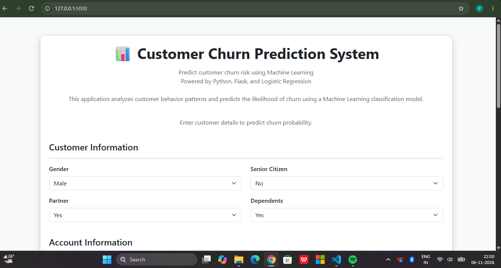
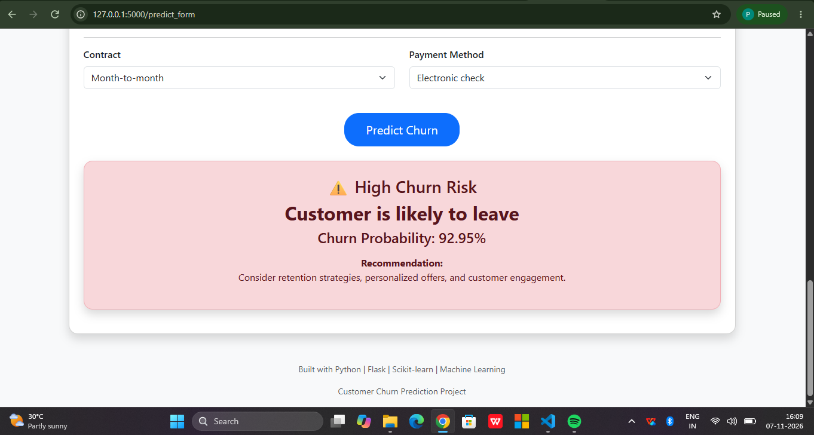
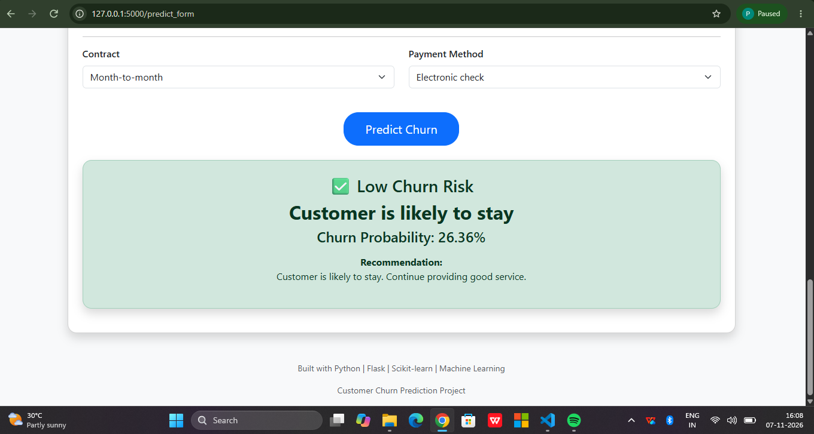

# Customer Churn Prediction System 📊

An end-to-end Machine Learning project that predicts whether a customer is likely to churn based on customer demographics, account information, and subscribed services.

The project covers the complete Data Science workflow including data preprocessing, exploratory data analysis, feature engineering, model experimentation, evaluation, and deployment using Flask.

---

# 🚀 Project Overview

Customer churn prediction helps businesses identify customers who are likely to stop using their services.

The objective of this project is to build a classification system that can:

- Analyze customer behavior patterns
- Predict churn risk
- Estimate churn probability
- Provide actionable insights for customer retention

The final application allows users to enter customer details through a web interface and receive real-time churn predictions.

---

# 🎯 Problem Statement

Customer retention is a major challenge for businesses. Identifying customers who are likely to leave helps organizations take preventive actions such as personalized offers, customer engagement strategies, and service improvements.

This project aims to develop a machine learning classification model to predict customer churn using historical customer data.

---

# 📂 Dataset

## IBM Telco Customer Churn Dataset

The dataset contains customer information related to:

- Demographics
- Account details
- Service subscriptions
- Billing information

### Dataset Details

- Total Records: 7043
- Original Features: 21
- Target Variable: `Churn`

### Target Classes

| Value | Meaning |
|---|---|
| Yes | Customer churned |
| No | Customer stayed |

---

# 🛠️ Technologies Used

## Programming Language

- Python

## Data Analysis & Processing

- Pandas
- NumPy

## Data Visualization

- Matplotlib
- Seaborn

## Machine Learning

- Scikit-learn

Algorithms explored:

- Logistic Regression
- Decision Tree Classifier
- Random Forest Classifier

## Deployment

- Flask
- HTML
- CSS
- Bootstrap

## Tools

- Jupyter Notebook
- VS Code
- Postman
- Git/GitHub

---

# 🔄 Machine Learning Workflow

The project follows an end-to-end machine learning pipeline:

```
Data Collection
        ↓
Data Cleaning
        ↓
Exploratory Data Analysis
        ↓
Feature Engineering
        ↓
Data Preprocessing
        ↓
Model Training
        ↓
Model Evaluation
        ↓
Model Selection
        ↓
Flask Deployment
```

---

# 🧹 Data Preprocessing

The following preprocessing steps were performed:

- Handled missing values
- Converted numerical and categorical features
- Applied One-Hot Encoding for categorical variables
- Converted binary categorical values into numerical format
- Prepared features for machine learning algorithms
- Maintained consistent feature order during deployment

---

# 📊 Exploratory Data Analysis

EDA was performed to understand customer behavior and identify churn patterns.

Analysis included:

- Customer distribution
- Churn distribution
- Contract type analysis
- Payment method analysis
- Monthly charges analysis
- Tenure relationship with churn

Insights from EDA helped in understanding factors influencing customer churn.

---

# 🤖 Model Development

Multiple classification models were trained and evaluated:

## 1. Logistic Regression

Used as a baseline classification model.

Advantages:
- Suitable for binary classification
- Provides probability predictions
- Easy interpretation for business problems


## 2. Decision Tree Classifier

Used to capture rule-based decision patterns from customer data.


## 3. Random Forest Classifier

Used as an ensemble learning approach to improve prediction performance by combining multiple decision trees.

---

# 📈 Model Evaluation

Models were evaluated using:

- Accuracy
- Precision
- Recall
- F1-score
- ROC-AUC Score

For churn prediction, recall and F1-score for the churn class were considered important because identifying customers at risk is the main objective.

---

# 🏆 Final Model Selection

After comparing multiple models, Logistic Regression was selected as the final deployment model.

Reasons:

- Provides churn probability scores
- Easy interpretation
- Suitable for business decision-making
- Good balance between performance and explainability

---

# 📊 Final Model Performance

## Logistic Regression

| Metric | Score |
|---|---|
| Accuracy | 80% |
| ROC-AUC Score | 0.8361 |
| Churn Precision | 65% |
| Churn Recall | 57% |
| Churn F1-score | 61% |

---

# 🌐 Application Features

The deployed Flask application provides:

✅ Customer information input form  
✅ Real-time churn prediction  
✅ Churn probability percentage  
✅ Risk classification  
✅ Business recommendation based on prediction  
✅ Interactive web interface  

---

# 📁 Project Structure

```
Customer Churn Prediction/

│
├── app/
│   │
│   ├── app.py
│   │
│   ├── templates/
│   │   └── index.html
│   │
│   └── static/
│       └── css/
│           └── style.css
│
├── models/
│   │
│   ├── encoder.pkl
│   ├── categorical_columns.pkl
│   ├── feature_columns.pkl
│   └── final_churn_model.pkl
│
├── data/
│
├── notebooks/
│
├── reports/
│
├── requirements.txt
│
└── README.md
```

---

# ⚙️ How to Run the Project Locally

## 1. Clone Repository

```bash
git clone <repository-url>
```

## 2. Navigate to Project Folder

```bash
cd Customer-Churn-Prediction
```

## 3. Create Virtual Environment

```bash
python -m venv .venv
```

Activate environment:

Windows:

```bash
.venv\Scripts\activate
```

## 4. Install Dependencies

```bash
pip install -r requirements.txt
```

## 5. Run Flask Application

```bash
python app/app.py
```

## 6. Open Browser

```
http://127.0.0.1:5000/
```

---

# 📸 Application Screenshots

## 🏠 Home Page

Shows the customer input form for entering customer details.



---

## 📈 High Churn Prediction

Example of a customer predicted as high churn risk with probability and recommendation.



---

## ✅ Low Churn Prediction

Example of a customer predicted as low churn risk.



---


# 🔮 Future Improvements

Possible improvements:

- Deploy application using cloud platforms
- Add model comparison dashboard
- Improve churn recall using advanced techniques
- Add customer segmentation
- Integrate explainable AI techniques such as SHAP
- Build automated ML pipelines

---

# 💡 Key Learnings

Through this project, I gained experience in:

- Data preprocessing pipelines
- Feature engineering
- Classification algorithms
- Model evaluation
- Handling imbalanced datasets
- Model deployment using Flask
- Connecting machine learning models with web applications

---

# 👩‍💻 Author

**Princy P**

B.Sc Computer Science with Data Science

---

# ⭐ Project Highlights

This project demonstrates:

- Complete machine learning lifecycle
- Multiple model experimentation
- Deployment of ML models into